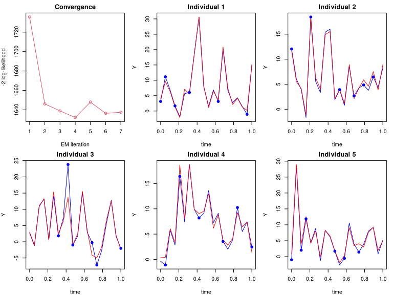
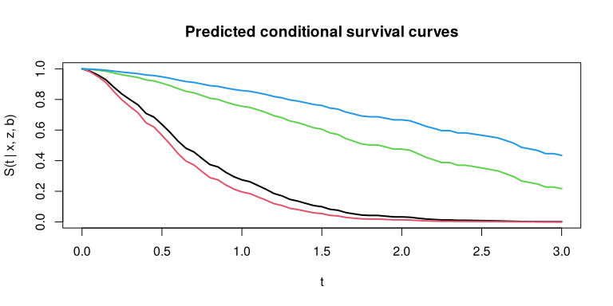

<!-- README.md is generated from README.Rmd. Edit README.Rmd, then run
     devtools::build_readme(). -->

# MEXGB

MEXGB: An R package for Mixed-Effect Extreme Gradient Boosting for
high-dimensional longitudinal and clustered data with continuous, binary
and right-censored survival outcomes.

# Mixed-Effect Extreme Gradient Boosting (MEXGB) Algorithm

MEXGB is an adaptation of extreme gradient boosting (XGBoost; Chen and
Guestrin, 2016) to longitudinal and clustered data. It extends the Mixed
Effect Gradient Boosting (MEGB) algorithm of Olaniran et al. (2025),
itself built on the Mixed Effect Random Forest (MERF) of Hajjem et al.
(2014) as implemented by Capitaine et al. (2021). The fixed effect is
fitted by regularised second-order (Newton) tree boosting with the
`xgboost` package, optionally together with a penalised linear part
fitted by `glmnet`. Subject-specific random effects and variance
components are estimated by an Expectation–Maximisation (EM) / Best
Linear Unbiased Prediction (BLUP) scheme, which is extended to binary
and survival outcomes by penalised quasi-likelihood (PQL) and a Laplace
approximation.

## The model

Let $y_{ij}$ be the outcome of individual $i=1,\dots,n$ at occasion
$j=1,\dots,n_i$ ($N=\sum_i n_i$), with fixed-effect predictors
$x_{ij}\in\mathbb{R}^p$ ($p$ may exceed $N$) and random-effect design
$z_{ij}\in\mathbb{R}^q$ (for example $z_{ij}=(1,t_{ij})^\top$). MEXGB
estimates the semi-parametric mixed-effects model with conditional
linear predictor

$$\eta_{ij}=f(x_{ij})+z_{ij}^\top\beta_z+z_{ij}^\top b_i,\qquad b_i\sim N_q(0,D),$$

where $f$ is an unknown function, $\beta_z$ are population coefficients
of the columns of $Z$ (so that the $b_i$ have mean zero) and $D$ is the
random-effect covariance. Three outcome families are supported:

| `family`     | Model                                                                                                                |
|--------------|----------------------------------------------------------------------------------------------------------------------|
| `"gaussian"` | $y_{ij}=\eta_{ij}+\epsilon_{ij}$, $\epsilon_{ij}\sim N(0,\sigma^2)$ independent given $b_i$                          |
| `"binomial"` | $\text{logit} P(y_{ij}=1\mid b_i)=\eta_{ij}$                                                                 |
| `"cox"`      | $\lambda_{ij}(t\mid b_i)=\lambda_0(t)\exp(\eta_{ij})$ (log-normal frailty Cox model; clustered right-censored times) |

The fixed effect is

$$f(x)=a+x^\top\gamma+\sum_{m=1}^{M}\nu\,T_m(x),$$

a penalised (relaxed) lasso linear part $a+x^\top\gamma$ plus $M$
regression trees $T_m$ with learning rate $\nu$ (`shrinkage`). The
linear part is optional (`linear`).

## Estimation

MEXGB alternates an M-step for $f$ and an E-step for
$(b_i,\beta_z,D,\sigma^2)$.

**M-step (Newton boosting with an offset).** With the current
random-effect contribution $o_{ij}=z_{ij}^\top(\hat\beta_z+\hat b_i)$
held fixed as an offset (`base_margin`), $f$ is fitted by minimising the
exact loss $\ell$ (squared error, logistic loss or negative Cox partial
log-likelihood) of $\eta_{ij}=f(x_{ij})+o_{ij}$. Tree $m$ is grown on
the gradients $g_{ij}=\partial\ell/\partial\eta_{ij}$ and Hessians
$h_{ij}=\partial^2\ell/\partial\eta_{ij}^2$:

$$T_m=\arg\min_T\sum_{ij}\\Bigl[g_{ij}T(x_{ij})+\tfrac12 h_{ij}T(x_{ij})^2\\Bigr]+\gamma_{\rm split}|T|+\tfrac12\lambda\sum_{\ell}w_\ell^2+\alpha\sum_{\ell}|w_\ell|,$$

so that a leaf with index set $I_\ell$ has weight
$w_\ell=-\sum_{I_\ell}g/(\sum_{I_\ell}h+\lambda)$ when $\alpha=0$. For
the Gaussian family $g=\eta-y$ and $h=1$; for the binary family
$g=\mu-y$ and $h=\mu(1-\mu)$ with $\mu=\text{expit}(\eta)$; for
the Cox family $g$ and $h$ are those of the Breslow partial likelihood.

**Cross-fitting.** The observations of every individual are spread over
$V$ folds (`crossfit`). For row $(i,j)$ in fold $v$, the E-step uses the
out-of-fold fixed effect $\hat f^{(-v)}(x_{ij})$ fitted without fold
$v$. An in-sample booster interpolates the partial residuals
$y-z^\top\hat b$ and drives $\hat D$ to zero; cross-fitting prevents
this collapse. The booster used for prediction is fitted on all rows.
The number of trees $M$ is the minimiser of the out-of-fold loss
(`ntree_select = "cv"`, rescaled by $V/(V-1)$ for the full fit; `ntree`
is the maximum), the linear part and the predictor screening (`screen`)
are also chosen out of fold.

**E-step, Gaussian outcomes (BLUP/EM as in MERF and MEGB).** With
$r_i=y_i-\hat f_i-Z_i\hat\beta_z$ and
$V_i=Z_iDZ_i^\top+\sigma^2I_{n_i}$,

$$\hat b_i=DZ_i^\top V_i^{-1}r_i,\qquad
\hat\sigma^2=\frac1N\sum_i\\Bigl\{\hat\epsilon_i^\top\hat\epsilon_i+\sigma^2\\Bigl(n_i-\sigma^2\text{tr}V_i^{-1}\\Bigr)\\Bigr\},$$

$$\hat D=\frac1n\sum_i\\Bigl\{\hat b_i\hat b_i^\top+D-DZ_i^\top V_i^{-1}Z_iD\\Bigr\},\qquad
\hat\epsilon_i=r_i-Z_i\hat b_i,$$

iterated to convergence (`inner`, `inner_tol`) for the current $\hat f$
before the next M-step. The EM is monitored with

$$-2\ell(f,D,\sigma^2)=\sum_i\\Bigl\{\log|V_i|+r_i^\top V_i^{-1}r_i\\Bigr\}+\text{const}.$$

When `heldout_blup = TRUE`, the random effect of a held-out row is
predicted only from the other folds’ rows of the same individual, as for
a new measurement; these held-out BLUPs give the offsets of the
out-of-fold losses (`heldout_offset`) and the held-out squared error
used to choose a scale
$c\in\{0,\tfrac1{16},\tfrac18,\tfrac14,\tfrac12,1\}$ for $D$
(`heldout_dscale`; $c<1$ is used only when it beats $c=1$ by a paired
$z$ statistic above 2).

**E-step, binary outcomes (PQL with a Laplace correction).** The model
is linearised at the current fit: with
$\mu_{ij}=\text{expit}(\eta_{ij})$ and
$w_{ij}=\mu_{ij}(1-\mu_{ij})$, the working response and covariance are

$$\tilde y_{ij}=\eta_{ij}+\frac{y_{ij}-\mu_{ij}}{w_{ij}},\qquad V_i=Z_iDZ_i^\top+W_i^{-1},$$

and the Gaussian updates are applied to $\tilde y$ with $\sigma^2I$
replaced by $W_i^{-1}=\text{diag}(1/w_{ij})$. Because the PQL
estimate of $D$ is biased downwards, `estep = "laplace"` then
re-estimates $D$ by maximising the Laplace approximation

$$\ell_L(D)=\sum_i\\Bigl\{\log p(y_i\mid\tilde b_i)-\tfrac12\tilde b_i^\top D^{-1}\tilde b_i-\tfrac12\log\\Bigl|I_q+DZ_i^\top W_iZ_i\\Bigr|\\Bigr\},$$

with $\tilde b_i$ the posterior modes, as in `lme4::glmer` (`nAGQ = 1`).

**E-step, survival outcomes.** The Cox partial likelihood is represented
as a Poisson likelihood with mean
$\mu_{ij}=\hat\Lambda_0(t_{ij})e^{\eta_{ij}}$, where $\hat\Lambda_0$ is
the Breslow cumulative baseline hazard. The PQL working quantities are
$w_{ij}=\mu_{ij}$ and
$\tilde y_{ij}=\eta_{ij}+(\delta_{ij}-\mu_{ij})/\mu_{ij}$, with
$\delta_{ij}$ the event indicator (Ripatti and Palmgren, 2000). The
random intercepts are centred because their mean is absorbed by
$\lambda_0$, and the boosted predictor is rescaled by its out-of-fold
calibration slope (`calibrate`), since boosted Cox models over-fit the
partial likelihood.

**Stopping.** The EM stops when the relative change of the criterion is
below `delta`, or when it has not improved for `stall_iter` consecutive
iterations; the iteration with the best criterion (for Gaussian data
with cross-fitting, the smallest held-out squared error) is returned.

**Prediction.** For an individual seen in training,
$\hat\eta=\hat f(x)+z^\top(\hat\beta_z+\hat b_i)$; for a new individual
$\hat b_i=0$. `predict()` returns $\hat\eta$ (Gaussian),
$\text{expit}(\hat\eta)$ (binary), the relative hazard
$e^{\hat\eta}$ (Cox), or the conditional survival
$\hat S(t\mid x,z)=\exp\{-\hat\Lambda_0(t)e^{\hat\eta}\}$
(`type = "survival"`).

## Installation

``` r
# Released version (after CRAN acceptance):
install.packages("MEXGB")
# Development version from GitHub:
# install.packages("devtools")
devtools::install_github("rid4stat/MEXGB")
```

## Usage

``` r
MEXGB(
  X,                        # [matrix] N x p predictors of the fixed effect.
  Y,                        # [vector] Outcome: numeric (gaussian), 0/1 (binomial), or a
                            #   two-column (time, status) matrix / right-censored Surv (cox).
  id,                       # [vector] Individual (cluster) identifier of every row.
  Z,                        # [matrix] N x q random-effect design, e.g. cbind(1, time).
  iter = 100,               # [numeric] Maximum number of EM iterations.
  ntree = 5000,             # [numeric] Maximum number of boosting rounds per M-step.
  time,                     # [vector] Measurement time of every row.
  shrinkage = 0.1,          # [numeric] Learning rate (xgboost eta).
  interaction.depth = 1,    # [numeric] Maximum tree depth (xgboost max_depth).
  n.minobsinnode = 5,       # [numeric] Minimum leaf size, mapped to min_child_weight.
  lambda = 1,               # [numeric] L2 penalty on leaf weights.
  alpha = 0,                # [numeric] L1 penalty on leaf weights.
  gamma = 0,                # [numeric] Minimum loss reduction to make a split.
  subsample = 1,            # [numeric] Row subsampling rate per tree.
  colsample_bytree = 1,     # [numeric] Column subsampling rate per tree.
  min_child_weight = NULL,  # [numeric] Override of the minimum Hessian weight in a leaf.
  family = "gaussian",      # [character] "gaussian", "binomial" or "cox".
  delta = 0.001,            # [numeric] Relative-change convergence threshold of the EM.
  stall_iter = 5,           # [numeric] Stop after this many EM iterations without improvement.
  eps = 1e-6,               # [numeric] Lower bound of the PQL working weights.
  crossfit = 5,             # [numeric] Number of within-subject cross-fitting folds (0 = off).
  init = "auto",            # [character] EM starting values: "auto", "lmm" or "zero".
  dispersion = "auto",      # [character] PQL residual structure: "auto", "additive",
                            #   "multiplicative" or "none".
  inner = 50,               # [numeric] Maximum E-step iterations per boosting refit.
  inner_tol = 1e-4,         # [numeric] Convergence tolerance of the inner E-step iterations.
  calibrate = TRUE,         # [logical] Out-of-fold calibration slope (binary and cox).
  calibrate_binomial = TRUE,# [logical] Apply the calibration to binary outcomes.
  tree_method = "auto",     # [character] "auto", "exact", "hist" or "approx".
  linear = "auto",          # [logical / "auto"] Penalised linear part in the fixed effect.
  lin_alpha = 1,            # [numeric] Elastic-net mixing of the linear part (1 = lasso).
  lin_relax = TRUE,         # [logical] Also consider relaxed-lasso fits, chosen out of fold.
  screen = "auto",          # [character] Predictor screening by split gain: "auto" or "none".
  screen_iter = 2,          # [numeric] EM iterations at which screening is (re)decided.
  zfixed = TRUE,            # [logical] Estimate population coefficients beta_z for Z.
  heldout_blup = TRUE,      # [logical] Held-out random-effect prediction in out-of-fold losses.
  heldout_dscale = TRUE,    # [logical] Scale D by the held-out squared error.
  heldout_offset = TRUE,    # [logical] Held-out BLUP offsets in the M-step losses.
  ntree_select = "cv",      # [character] Number of trees: "cv" (out of fold) or "fixed".
  criterion = "laplace",    # [character] EM criterion for binary/cox: "laplace" or "working".
  estep = "laplace",        # [character] Variance update for binary/cox: "laplace" or "pql".
  nthread = 1,              # [numeric] Number of xgboost threads.
  seed = 1,                 # [numeric] Seed of the folds and of xgboost.
  verbose = TRUE            # [logical] Print the stopping message.
)

predict(object, X, Z, id, time,
        type = "response",  # "response", "link" or "survival" (cox only)
        times = NULL)       # time grid for type = "survival"

simLong(n, p, rel_p = 6, time_points = 10, rho_W = 0.6, rho_Z = 0.6,
        random_sd_intercept = sqrt(0.5), random_sd_slope = sqrt(3), noise_sd = 0.5,
        linear = TRUE, family = "gaussian", target_auc = NULL, prevalence = 0.5,
        target_c = NULL, signal = NULL, intercept = NULL, censoring = 0.3,
        weibull_shape = 1.5, weibull_scale = 1, pilot_n = 300, pilot_seed = 1,
        calibration = NULL)

calibrateSim(family = "binomial", target, prevalence = 0.5, ...)
```

The defaults are those used in the MEXGB papers. In most applications
only `X`, `Y`, `id`, `Z`, `time`, `family` and the tree settings
(`ntree`, `shrinkage`, `interaction.depth`) need attention. See `?MEXGB`
for the full description of every argument.

## Output

A fitted `MEXGB` object is a list that includes:

- `forest`: the selected booster (`booster`), linear coefficients
  (`beta`), intercept and predictor indices of the fixed effect.
- `random_effects`: predicted random effects $\hat b_i$ (one row per
  individual).
- `id_btilde`: identifiers of the individuals associated with
  `random_effects`.
- `var_random_effects`: estimated random-effect covariance $\hat D$.
- `sigma`: residual variance $\hat\sigma^2$ (Gaussian) or PQL dispersion
  (binary, cox).
- `beta_z`: population coefficients of the columns of `Z`.
- `LL`: $-2\times$ the log-likelihood criterion at every EM iteration.
- `OOB`: training error of the boosted fixed effect at every iteration.
- `heldout_loss`, `d_scale`: Gaussian held-out squared error and
  selected scale of $D$.
- `importance`: relative importance (%) of every predictor.
- `nrounds`, `linear`, `screened`: selected number of trees, whether the
  linear part is used, and the screened predictors.
- `converged`, `n_iter`, `best_iter`, `laplace_diagnostics`: convergence
  information.
- `baseline` (cox only): Breslow cumulative baseline hazard.
- `time`, `id`, `feature_names`, `family`: training information.

## Examples

All examples use data simulated by `simLong()` with the design of the
MEXGB papers: $n=50$ individuals with 20 occasions each, of which 6
(30%) per individual are held out as a test set. The test rows belong to
individuals seen in training, so the predictions use their estimated
random effects.

``` r
library(MEXGB)
library(xgboost)
library(survival)

## hold out 6 of the 20 measurements of every individual
split_rows <- function(id, n_test = 6, seed = 1) {
  set.seed(seed)
  unlist(lapply(split(seq_along(id), id), function(r) sample(r, n_test)))
}
```

### 1. Continuous outcome

Nonlinear fixed effect
$f(x)=2\sin(\pi x_1x_2)+4(x_3-0.5)^2+2x_4+e^{x_5}+x_6x_1$, random
intercept and slope with $D_{11}=0.5$, $D_{22}=3$,
$D_{12}=0.6\sqrt{1.5}\approx0.73$, and AR(1) errors with
$\sigma^2=0.25$, $\rho_W=0.6$. The part of $f$ the trees do not capture
from 700 training rows is absorbed by $\hat\sigma^2$, which therefore
exceeds 0.25.

``` r
set.seed(1)
data <- simLong(n = 50, p = 6, rel_p = 6, time_points = 20, rho_W = 0.6, rho_Z = 0.6,
                random_sd_intercept = sqrt(0.5), random_sd_slope = sqrt(3),
                noise_sd = 0.5, linear = FALSE)
head(data[, 1:8])
#>   id       time         Y RandomIntercept RandomSlope       Var1       Var2       Var3
#> 1  1 0.00000000  3.110325               1  0.00000000 -0.6264538  0.5320998 -0.3896598
#> 2  1 0.05263158 11.142047               1  0.05263158  0.1836433  0.9997315 -0.9379650
#> 3  1 0.10526316  6.751135               1  0.10526316 -0.8356286 -1.1979993  0.5769610
#> 4  1 0.15789474  1.671658               1  0.15789474  1.5952808  1.1257537  1.0908682
#> 5  1 0.21052632 -1.819479               1  0.21052632  0.3295078  0.2532212  0.1072528
#> 6  1 0.26315789  5.662506               1  0.26315789 -0.8204684 -1.8224001 -0.5363060
X <- as.matrix(data[, grep("^Var", names(data))])
Z <- as.matrix(data[, c("RandomIntercept", "RandomSlope")])
test <- split_rows(data$id)
```

``` r
fit <- MEXGB(X = X[-test, ], Y = data$Y[-test], id = data$id[-test], Z = Z[-test, ],
             time = data$time[-test], ntree = 500, interaction.depth = 2, verbose = TRUE)
#> [1] "stopped after 7 iterations."
fit
#> Mixed Effect Extreme Gradient Boosting (MEXGB)
#>   family: gaussian 
#>   individuals: 50  observations: 700 
#>   random effects: 2  selected boosting rounds: 612 
#>   EM iterations: 7 (converged) 
#>   estimated random-effect covariance:
#>        [,1]   [,2]
#> [1,] 0.2344 0.8830
#> [2,] 0.8830 4.0197
#>   estimated residual variance: 3.1729
summary(fit)             # relative importance of the predictors (%)
#>       var   rel.inf
#> Var3 Var3 58.988073
#> Var4 Var4 20.298168
#> Var5 Var5 10.530469
#> Var1 Var1  4.059680
#> Var2 Var2  3.294877
#> Var6 Var6  2.828733
fit$sigma                # residual variance
#>          [,1]
#> [1,] 3.172938
head(fit$random_effects) # predicted random intercepts and slopes
#>             [,1]       [,2]
#> [1,] -0.12640867 -0.5075384
#> [2,] -0.25707301 -1.1234505
#> [3,] -0.98490702 -4.2944051
#> [4,]  0.01062987  0.1234829
#> [5,] -0.38859805 -1.6521494
#> [6,]  0.20462619  0.8929903
fit$nrounds; fit$linear  # selected number of trees; linear part used?
#> [1] 612
#> [1] TRUE
```

Prediction for the held-out measurements, compared with plain XGBoost
using the same tree settings and the same number of trees:

``` r
pred <- predict(fit, X = X[test, ], Z = Z[test, ], id = data$id[test], time = data$time[test])
xgb <- xgb.train(params = list(objective = "reg:squarederror", eta = 0.1, max_depth = 2,
                               min_child_weight = 5, nthread = 1),
                 data = xgb.DMatrix(X[-test, ], label = data$Y[-test]),
                 nrounds = max(fit$nrounds, 1), verbose = 0)
c(MEXGB = mean((data$Y[test] - pred)^2),
  XGBoost = mean((data$Y[test] - predict(xgb, X[test, ]))^2))
#>    MEXGB  XGBoost 
#> 3.503779 7.698447
```

``` r
op <- par(mfrow = c(2, 3), mar = c(4, 4, 2, 1))
plot(fit$LL, type = "o", col = 2, xlab = "EM iteration", ylab = "-2 log-likelihood",
     main = "Convergence")
full <- predict(fit, X, Z, data$id, data$time)
for (i in 1:5) {
  w <- which(data$id == i)
  plot(data$time[w], data$Y[w], type = "l", col = "blue", xlab = "time", ylab = "Y",
       main = paste("Individual", i), ylim = range(data$Y[w], full[w]))
  lines(data$time[w], full[w], col = "red")
  points(data$time[intersect(w, test)], data$Y[intersect(w, test)], pch = 19, col = "blue")
}
```



``` r
par(op)
```

The blue lines are the observed trajectories (filled points: held-out
measurements) and the red lines the MEXGB predictions.

### 2. High-dimensional continuous outcome ($p = 200$)

Linear fixed effect on the first six of 200 predictors. MEXGB chooses
between the trees alone and trees plus a relaxed lasso, and screens the
predictors, all out of fold.

``` r
set.seed(2)
dh <- simLong(n = 50, p = 200, rel_p = 6, time_points = 20, linear = TRUE)
Xh <- as.matrix(dh[, grep("^Var", names(dh))])
Zh <- as.matrix(dh[, c("RandomIntercept", "RandomSlope")])
th <- split_rows(dh$id)
fith <- MEXGB(Xh[-th, ], dh$Y[-th], dh$id[-th], Zh[-th, ], time = dh$time[-th],
              ntree = 500, verbose = FALSE)
fith$linear                     # linear part selected
#> [1] TRUE
head(summary(fith), 8)          # the six active predictors lead the ranking
#>       var  rel.inf
#> Var1 Var1 22.61169
#> Var2 Var2 21.85559
#> Var3 Var3 17.02361
#> Var4 Var4 16.77955
#> Var5 Var5 11.00263
#> Var6 Var6 10.72694
round(fith$var_random_effects, 2)
#>      [,1] [,2]
#> [1,] 0.57 0.81
#> [2,] 0.81 3.88
predh <- predict(fith, Xh[th, ], Zh[th, ], dh$id[th], dh$time[th])
c(test_MSE = mean((dh$Y[th] - predh)^2))
#>  test_MSE 
#> 0.2057549
```

### 3. Binary outcome

The fixed-effect signal is calibrated so that its population AUC is
0.80, with prevalence 0.3.

``` r
set.seed(3)
db <- simLong(n = 50, p = 6, time_points = 20, linear = FALSE, family = "binomial",
              target_auc = 0.8, prevalence = 0.3)
mean(db$Y)                       # observed prevalence
#> [1] 0.275
Xb <- as.matrix(db[, grep("^Var", names(db))])
Zb <- as.matrix(db[, c("RandomIntercept", "RandomSlope")])
tb <- split_rows(db$id)
fitb <- MEXGB(Xb[-tb, ], db$Y[-tb], db$id[-tb], Zb[-tb, ], time = db$time[-tb],
              family = "binomial", ntree = 500, interaction.depth = 2, verbose = FALSE)
fitb
#> Mixed Effect Extreme Gradient Boosting (MEXGB)
#>   family: binomial 
#>   individuals: 50  observations: 700 
#>   random effects: 2  selected boosting rounds: 62 
#>   EM iterations: 4 (converged) 
#>   estimated random-effect covariance:
#>        [,1]   [,2]
#> [1,] 0.1496 0.3718
#> [2,] 0.3718 1.4611
prob <- predict(fitb, Xb[tb, ], Zb[tb, ], db$id[tb], db$time[tb])  # P(Y = 1)
head(round(prob, 3))
#> [1] 0.871 0.381 0.508 0.101 0.169 0.358
auc <- function(y, s) { r <- rank(s); n1 <- sum(y == 1); n0 <- sum(y == 0)
  (sum(r[y == 1]) - n1 * (n1 + 1) / 2) / (n1 * n0) }
c(test_AUC = auc(db$Y[tb], prob), Brier = mean((db$Y[tb] - prob)^2))
#>  test_AUC     Brier 
#> 0.8475843 0.1233624
```

### 4. Clustered survival outcome

Frailty Cox model with a Weibull baseline, fixed-effect concordance
calibrated to 0.75 and 30% censoring. `Y` is a two-column
`(time, status)` matrix (a right-censored `Surv` object can also be
used).

``` r
set.seed(4)
ds <- simLong(n = 50, p = 6, time_points = 20, linear = TRUE, family = "cox",
              random_sd_slope = sqrt(0.5), target_c = 0.75, censoring = 0.3)
head(ds[, c("id", "time", "Y", "status")])
#>   id       time         Y status
#> 1  1 0.00000000 0.1474599      1
#> 2  1 0.05263158 0.4686610      0
#> 3  1 0.10526316 0.1120827      1
#> 4  1 0.15789474 0.2372420      1
#> 5  1 0.21052632 0.2346386      1
#> 6  1 0.26315789 0.4121361      1
Xs <- as.matrix(ds[, grep("^Var", names(ds))])
Zs <- as.matrix(ds[, c("RandomIntercept", "RandomSlope")])
ts <- split_rows(ds$id)
fits <- MEXGB(Xs[-ts, ], cbind(ds$Y[-ts], ds$status[-ts]), ds$id[-ts], Zs[-ts, ],
              time = ds$time[-ts], family = "cox", ntree = 500, interaction.depth = 2,
              verbose = FALSE)
fits      # 0 boosting rounds: out of fold, the linear part alone predicted best (true f is linear)
#> Mixed Effect Extreme Gradient Boosting (MEXGB)
#>   family: cox 
#>   individuals: 50  observations: 700 
#>   random effects: 2  selected boosting rounds: 0 
#>   EM iterations: 3 (converged) 
#>   estimated random-effect covariance:
#>        [,1]   [,2]
#> [1,] 0.7031 0.0335
#> [2,] 0.0335 0.6406
lp <- predict(fits, Xs[ts, ], Zs[ts, ], ds$id[ts], ds$time[ts], type = "link")
c(test_C = unname(concordance(Surv(ds$Y[ts], ds$status[ts]) ~ lp, reverse = TRUE)$concordance))
#>  test_C 
#> 0.82088
## conditional survival probabilities of three held-out measurements
round(predict(fits, Xs[ts[1:3], ], Zs[ts[1:3], ], ds$id[ts[1:3]], ds$time[ts[1:3]],
              type = "survival", times = c(0.25, 0.5, 1, 2)), 3)
#>       0.25  0.50  1.00  2.00
#> [1,] 0.835 0.637 0.275 0.033
#> [2,] 0.797 0.566 0.196 0.013
#> [3,] 0.962 0.907 0.755 0.476
```

``` r
S <- predict(fits, Xs[ts[1:4], ], Zs[ts[1:4], ], ds$id[ts[1:4]], ds$time[ts[1:4]],
             type = "survival", times = seq(0, 3, by = 0.05))
matplot(seq(0, 3, by = 0.05), t(S), type = "l", lty = 1, lwd = 2, xlab = "t",
        ylab = "S(t | x, z, b)", main = "Predicted conditional survival curves")
```



### Predicting for new individuals

For an identifier not seen in training the random effects are set to
zero, while the population coefficients $\hat\beta_z$ of `Z` are kept:

``` r
head(predict(fit, X[1:3, ], Z[1:3, ], id = rep(999, 3), time = data$time[1:3]))
#> [1] 4.003363 9.779754 6.463885
```

## Practical notes

- Internal cross-fitting splits the observations within individuals. It
  tunes the model for further measurements of represented individuals;
  for new-individual evaluation hold out whole individuals, and for
  forecasting respect the time order.
- Binary and survival predictions for new individuals are conditional at
  $b_i=0$, not marginalised over the random effects.
- Survival responses are clustered right-censored times; start–stop and
  interval-censored data are not supported.
- Inspect `converged`, `best_iter` and `laplace_diagnostics` of a fit.

## Citation

If you use MEXGB, please cite the package and the methodological paper:

- Saheed, A. K., Olaniran, O. R., & Abdullah, M. A. A. (2026). *MEXGB:
  Mixed-Effect Extreme Gradient Boosting for Longitudinal Data*. R
  package version 1.0.0.
- Saheed, A. K., Olaniran, O. R., & Abdullah, M. A. A. (2026).
  Mixed-effect extreme gradient boosting for high-dimensional
  longitudinal data. *Submitted to Statistics and Computing*.

MEXGB builds on MEGB:

- Olaniran, O. R., Olaniran, S. F., Allohibi, J., Alharbi, A. A., &
  Alharbi, N. M. (2025). Mixed effect gradient boosting for
  high-dimensional longitudinal data. *Scientific Reports*, 15, 30927.
  <https://doi.org/10.1038/s41598-025-16526-z>
- Olaniran, O. R., & Olaniran, S. F. (2025). *MEGB: Gradient Boosting
  for Longitudinal Data*. R package version 0.2.
  <https://doi.org/10.32614/CRAN.package.MEGB>

``` bibtex
@Manual{MEXGB,
  title  = {MEXGB: Mixed-Effect Extreme Gradient Boosting for Longitudinal Data},
  author = {Oyebayo Ridwan Olaniran and Saheed Kunle Ajibade and Samuel Adewale Ajibade},
  year   = {2026},
  note   = {R package version 1.0.0}
}
@Article{MEXGB1,
  title   = {Mixed-effect extreme gradient boosting for high-dimensional longitudinal data},
  author  = {Oyebayo Ridwan Olaniran and Saheed Kunle Ajibade and Samuel Adewale Ajibade and Abdulhameed Bolakale and Nada MohammedSaeed Alharbi},
  journal = {Submitted to Statistics and Computing},
  year    = {2026}
}
@Article{OlaniranMEGB,
  title   = {Mixed effect gradient boosting for high-dimensional longitudinal data},
  author  = {Oyebayo Ridwan Olaniran and Saidat Fehintola Olaniran and Jeza Allohibi and
             Abdulmajeed Atiah Alharbi and Nada MohammedSaeed Alharbi},
  journal = {Scientific Reports},
  volume  = {15},
  pages   = {30927},
  year    = {2025},
  doi     = {10.1038/s41598-025-16526-z}
}
```

## References

- Capitaine, L., Genuer, R., & Thiébaut, R. (2021). Random forests for
  high-dimensional longitudinal data. *Statistical Methods in Medical
  Research*, 30(1), 166–184. <https://doi.org/10.1177/0962280220946080>
- Chen, T., & Guestrin, C. (2016). XGBoost: A scalable tree boosting
  system. *Proceedings of the 22nd ACM SIGKDD International Conference
  on Knowledge Discovery and Data Mining*, 785–794.
  <https://doi.org/10.1145/2939672.2939785>
- Hajjem, A., Bellavance, F., & Larocque, D. (2014). Mixed-effects
  random forest for clustered data. *Journal of Statistical Computation
  and Simulation*, 84(6), 1313–1328.
  <https://doi.org/10.1080/00949655.2012.741599>
- Olaniran, O. R., Olaniran, S. F., Allohibi, J., Alharbi, A. A., &
  Alharbi, N. M. (2025). Mixed effect gradient boosting for
  high-dimensional longitudinal data. *Scientific Reports*, 15, 30927.
  <https://doi.org/10.1038/s41598-025-16526-z>
- Ripatti, S., & Palmgren, J. (2000). Estimation of multivariate frailty
  models using penalized partial likelihood. *Biometrics*, 56(4),
  1016–1022. <https://doi.org/10.1111/j.0006-341X.2000.01016.x>

## License

GPL-2. The Gaussian EM/BLUP update code is adapted from MEGB 0.2 (see
`inst/NOTICE`).
